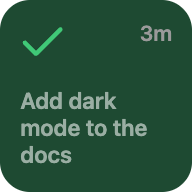
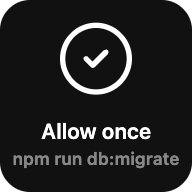
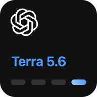
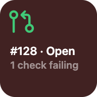
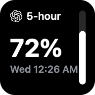
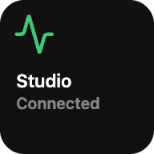
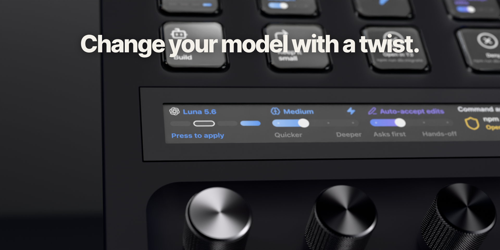
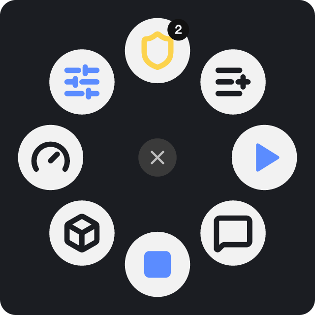
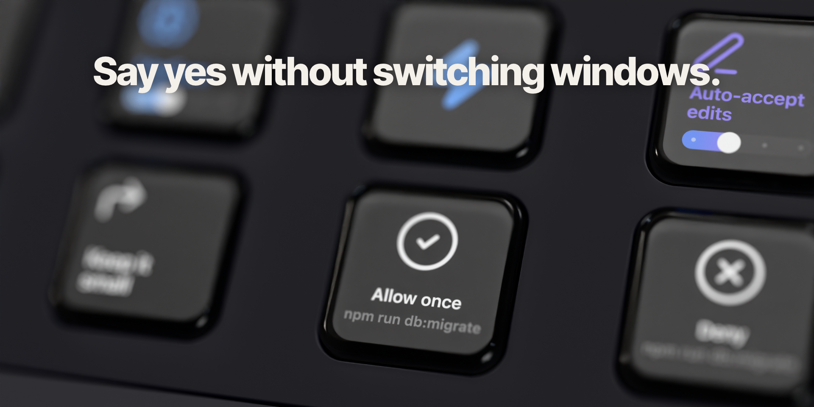

<h1>Turnkey for T3 Code</h1>

**Control [T3 Code](https://github.com/pingdotgg/t3code) from your Stream Deck or your Logitech mouse.** 
See every agent thread, approve and answer from a key, switch models and effort on a dial, and run git and pull request actions without switching to T3 Code.

&nbsp;&nbsp;&nbsp;&nbsp;

[Guide](docs/guide.md) · [Discussions](https://github.com/alejandrom2/turnkey/discussions) · [Contributing](CONTRIBUTING.md)

## What it does

<table>
<tr>
<td align="center" width="33%"> <b>Threads on keys and dials</b> Status, title and run time for every thread, tinted when one needs you. Tap to open it.</td>
<td align="center" width="33%"> <b>Act without switching windows</b> Approve, deny or answer agents, send prompts, steer or stop a turn.</td>
<td align="center" width="33%"> <b>Model controls</b> Model, effort, fast mode, access and plan mode, from keys or the Power dial.</td>
</tr>
<tr>
<td align="center" width="33%"> <b>Git and pull requests</b> Commit, push, open a PR, watch its checks and send Fix findings to the thread.</td>
<td align="center" width="33%"> <b>Usage and limits</b> Cost, tokens and subscription limit windows, as on T3 Code's Usage page.</td>
<td align="center" width="33%"> <b>Every provider and machine</b> Codex, Claude, Cursor, OpenCode and the rest, on local and remote T3 Code.</td>
</tr>
</table>

## Supported devices

Each device gets a ready-made Turnkey profile, and you can drag any action onto your own.

<table>
<tr>
<td width="40%"></td>
<td><b>Stream Deck +</b> Keys for everyday actions and dials for threads, usage, the Power dial (model, effort and access) and skills. Swipe the touch strip to a menu of folders: Threads, Controls, Prompts, Skills, Git, Pull Requests, Usage and More, each with its own dials.</td>
</tr>
<tr>
<td width="40%" align="center"></td>
<td><b>Stream Deck, XL and Mini</b> The 15-key Stream Deck has four thread keys and the everyday actions, then pages for threads, controls, skills, git and usage. The XL shows eight threads on its first page, and the Mini fits two threads with Activity, Approve and Stop.</td>
</tr>
<tr>
<td width="40%"></td>
<td><b>Stream Deck Neo</b> The Stream Deck + pages on keys. The info bar follows the page you're on: the most urgent thread on home, the model in Controls, the branch in Git, the pull request in Pull Requests, the queue in Prompts and the tightest limit in Usage.</td>
</tr>
<tr>
<td width="40%"></td>
<td><b>Logitech Actions Ring</b> T3 Code gets its own Actions Ring on an MX mouse or keyboard: the thread that needs you, Continue and Stop, and folders for your threads, quick prompts, models and limits. Each slot shows live state, and hovering names its thread, model or limit. An MX Master 4 buzzes when a thread needs approval, asks a question, finishes or fails.</td>
</tr>
</table>

## See it

https://github.com/user-attachments/assets/64852819-5e90-46e4-a6ac-824dbe0ff64f

## Get started

Turnkey connects the way T3 Code's own web and mobile clients do: a pair link, then a live WebSocket feed of your threads. It doesn't read app files or drive the UI, and it talks only to the T3 Code servers you pair it with.

### Stream Deck

You need the Stream Deck app 7.6 or newer on macOS 12+ or Windows 10+, and [T3 Code](https://github.com/pingdotgg/t3code) running on this computer or one you can reach. Turnkey works on the Stream Deck +, the 15-key Stream Deck, XL, Mini and Neo; dials need a Stream Deck +.

1. **Install.** Download `com.alejandrom2.turnkey.streamDeckPlugin` from the [latest release](https://github.com/alejandrom2/turnkey/releases/latest) and double-click it. Stream Deck offers Turnkey's ready-made profiles: pick one, or drag actions from the **Turnkey** category onto your deck.
2. **Create a pair link.** In T3 Code, open **Settings → Sharing & access** and create one.
3. **Connect.** In Stream Deck, open any Turnkey action's settings, paste the link under **Add a machine** and press **Connect**.

Add each machine once; every action can follow one machine or all of them. Pairings last 30 days, and you can revoke Turnkey anytime from **Sharing & access** in T3 Code.

### Logitech

You need Logi Options+ on macOS, an MX mouse or keyboard with the Actions Ring, and T3 Code as above. Haptics need an MX Master 4. Windows isn't tested yet.

1. **Install.** Download `Turnkey_<version>.lplug4` from the [latest release](https://github.com/alejandrom2/turnkey/releases/latest) and open it to install it in Logi Options+.
2. **Pair.** In Options+, Turnkey's actions show a **Pair with T3 Code** banner. Its button opens a Turnkey Settings page on this computer: paste a pair link from T3 Code's **Settings → Sharing & access** and press **Connect**.
3. **Pick the ring.** In Options+, add T3 Code to the Actions Ring and choose its **Default** profile. Rearrange it as you like, or put Turnkey's actions on any other profile. **Turnkey Settings** on the ring reopens the settings page.

The [guide](docs/guide.md) covers every action, the settings window, profiles, extra access and known limits.

## Support Turnkey

Turnkey is free. If it saves you some clicks, an energy drink keeps it going. ⚡

## Contributing

Bug reports, fixes, translations and ideas are welcome. See [CONTRIBUTING.md](CONTRIBUTING.md) for setup and house rules, and [SECURITY.md](SECURITY.md) to report a vulnerability privately. Turnkey's translations were machine-made, so corrections from native speakers help a lot.

## License

MIT © 2026 Alejandro Martinez. See [LICENSE](LICENSE). Bundled third-party code and assets keep their own licenses: T3 Code (MIT) and Lucide (ISC), in [LICENSES](LICENSES).

<b>Disclaimer</b>: Turnkey is an independent project, not affiliated with T3 Code or the companies it names.

 

Turnkey is an independent project. It is not affiliated with, endorsed by, or sponsored by T3 Code or its creators, Elgato or Logitech, or by any of the companies below.

T3 Code is a product of T3 Tools Inc. Claude and Claude Code are trademarks of Anthropic, PBC. OpenAI, ChatGPT and Codex are trademarks of OpenAI. Cursor is a trademark of Anysphere, Inc. Grok is a trademark of xAI. Antigravity and Gemini are trademarks of Google LLC. OpenCode, Pi, Muse and any other agent or provider names belong to their respective owners. GitHub is a trademark of GitHub, Inc. Stream Deck is a trademark of Corsair Memory, Inc. Logitech, Logi, Logi Options+, MX Master and Actions Ring are trademarks of Logitech. All other names, logos and brands are the property of their respective owners and are used only to identify the services Turnkey works with.

Provider marks are shown as T3 Code shows them, to identify the agent a thread runs on. Portions of Turnkey (usage and limits math, prompt texts, provider marks) are adapted from T3 Code under the MIT license; see LICENSES/t3code.txt. Icons are from Lucide under the ISC license; see LICENSES/lucide.txt.

Turnkey talks only to the T3 Code servers you pair it with. It sends nothing to its maker, and it doesn't run or bill any AI model itself: your agents' usage stays with your own provider accounts in T3 Code.

