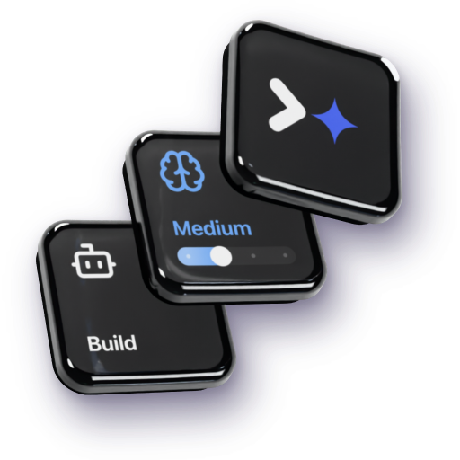
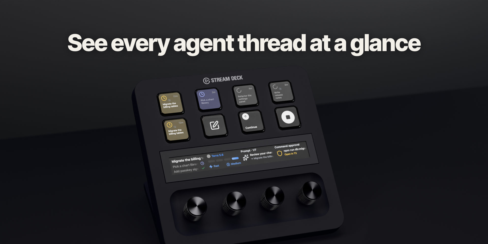
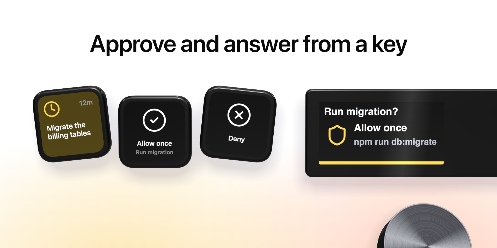
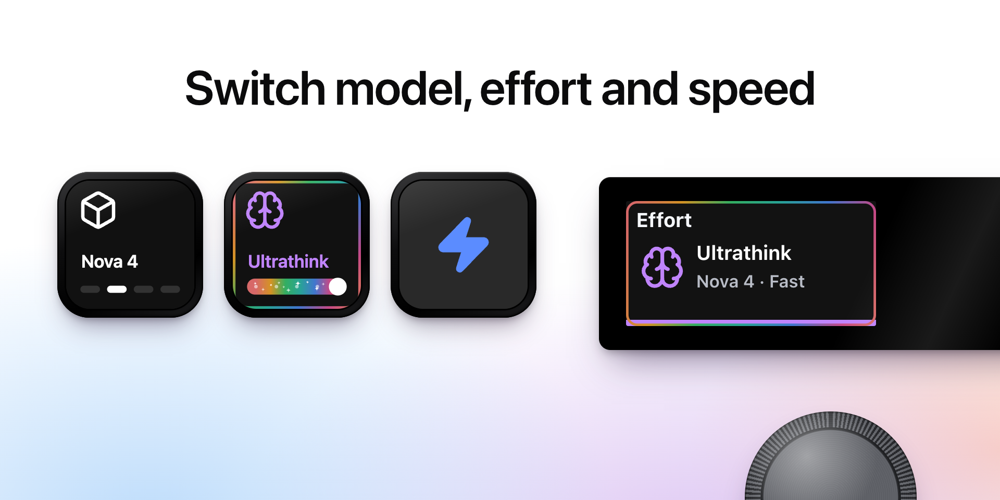
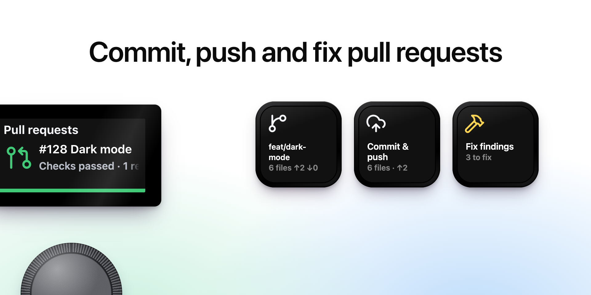
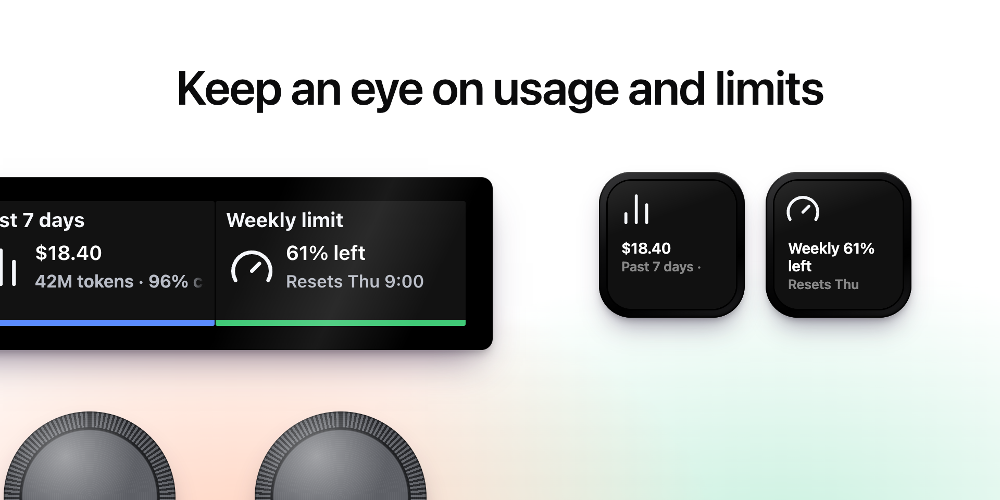

# Turnkey for T3 Code

**Control [T3 Code](https://github.com/pingdotgg/t3code) from your Stream Deck.** 
See every agent thread at a glance, approve and answer from a key, switch models and effort on a dial, and run git and pull request actions without leaving your flow.

[Download](https://github.com/alejandrom2/turnkey/releases) · [Guide](docs/guide.md) · [Discussions](https://github.com/alejandrom2/turnkey/discussions) · [Contributing](CONTRIBUTING.md)

## What it does

- **Threads on keys and dials.** Status, title and run time for every thread, tinted when one waits for an approval or has a question. Tap to open it in T3 Code.
- **Act without switching windows.** Stop turns, send or queue prompts, steer a running turn, start threads, and approve, deny or answer agent questions.
- **Model controls.** Switch model, effort, fast mode, access and plan mode from keys or the Power dial, across providers.
- **Git and pull requests.** Commit, push, open a PR, watch its checks and send Fix findings to the thread.
- **Usage and limits.** Cost, tokens and subscription limit windows, as on T3 Code's Usage page.
- **Every provider, every machine.** Codex, Claude, Cursor, OpenCode and the rest, on local and remote T3 Code environments.

Turnkey connects the way T3 Code's own web and mobile clients do: a pair link, then a live WebSocket feed of your threads. It doesn't read app files or drive the UI, and it talks only to the T3 Code servers you pair it with.

<table>
<tr>
<td></td>
<td></td>
</tr>
<tr>
<td></td>
<td></td>
</tr>
</table>

## Requirements

- Stream Deck app 7.6 or newer, on macOS 12+ or Windows 10+
- Any Stream Deck: Stream Deck +, the 15-key Stream Deck, XL, Mini or Neo (dials need a Stream Deck +)
- [T3 Code](https://github.com/pingdotgg/t3code) running on this computer or one you can reach

## Install

1. Download `com.alejandrom2.turnkey.streamDeckPlugin` from the [latest release](https://github.com/alejandrom2/turnkey/releases) and double-click it.
2. Stream Deck offers Turnkey's ready-made profiles. Pick one, or drag actions from the **Turnkey for T3 Code** category onto your deck.

## Pair with T3 Code

1. In T3 Code, open **Settings → Sharing & access** and create a pair link.
2. In Stream Deck, open any Turnkey action's settings, paste the link under **Add a machine** and press **Connect**.

Add each machine once; every action can follow one machine or all of them. Pairings last 30 days, and you can revoke Turnkey anytime from **Sharing & access** in T3 Code.

The [guide](docs/guide.md) covers every action, the settings window, profiles, extra access and known limits.

## Contributing

Bug reports, fixes, translations and ideas are welcome. See [CONTRIBUTING.md](CONTRIBUTING.md) for setup and house rules, and [SECURITY.md](SECURITY.md) to report a vulnerability privately. Turnkey's translations were machine-made, so corrections from native speakers help a lot.

If Turnkey saves you some clicks, you can [buy me an energy drink](https://github.com/sponsors/alejandrom2). ⚡

## License

MIT © 2026 Alejandro Martinez. See [LICENSE](LICENSE). Bundled third-party code and assets keep their own licenses: T3 Code (MIT) and Lucide (ISC), in [LICENSES](LICENSES).

## Disclaimer

Turnkey is an independent project. It is not affiliated with, endorsed by, or sponsored by T3 Code or its creators, or by any of the companies below.

T3 Code is a product of T3 Tools Inc. Claude and Claude Code are trademarks of Anthropic, PBC. OpenAI, ChatGPT and Codex are trademarks of OpenAI. Cursor is a trademark of Anysphere, Inc. Grok is a trademark of xAI. Antigravity and Gemini are trademarks of Google LLC. OpenCode, Pi, Muse and any other agent or provider names belong to their respective owners. GitHub is a trademark of GitHub, Inc. Elgato and Stream Deck are trademarks of Corsair Memory, Inc. All other names, logos and brands are the property of their respective owners and are used only to identify the services Turnkey works with.

Provider marks are shown as T3 Code shows them, to identify the agent a thread runs on. Portions of Turnkey (usage and limits math, prompt texts, provider marks) are adapted from T3 Code under the MIT license; see LICENSES/t3code.txt. Icons are from Lucide under the ISC license; see LICENSES/lucide.txt.

Turnkey talks only to the T3 Code servers you pair it with. It sends nothing to its maker, and it doesn't run or bill any AI model itself: your agents' usage stays with your own provider accounts in T3 Code.
